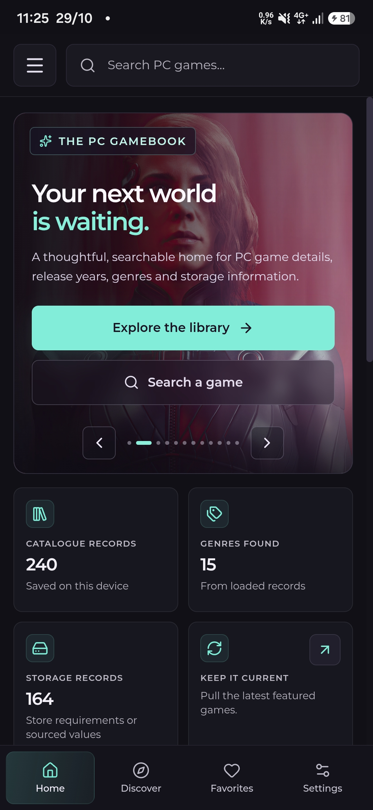
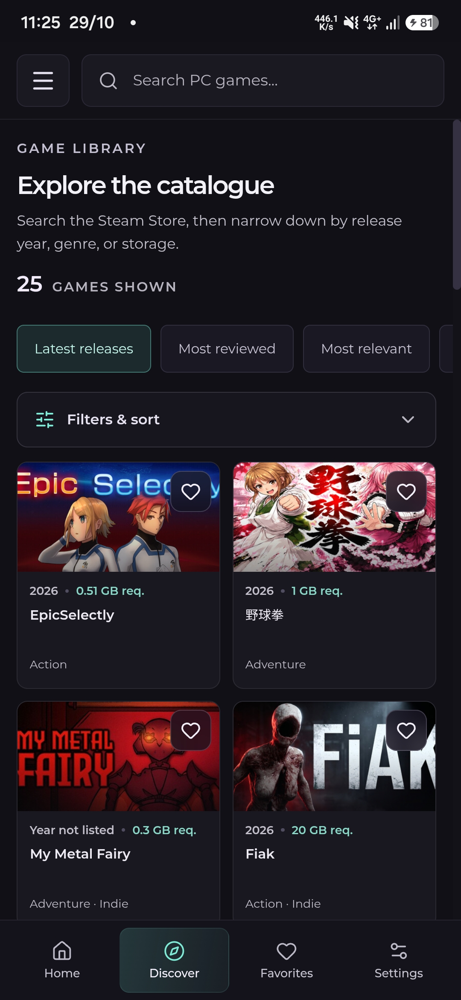
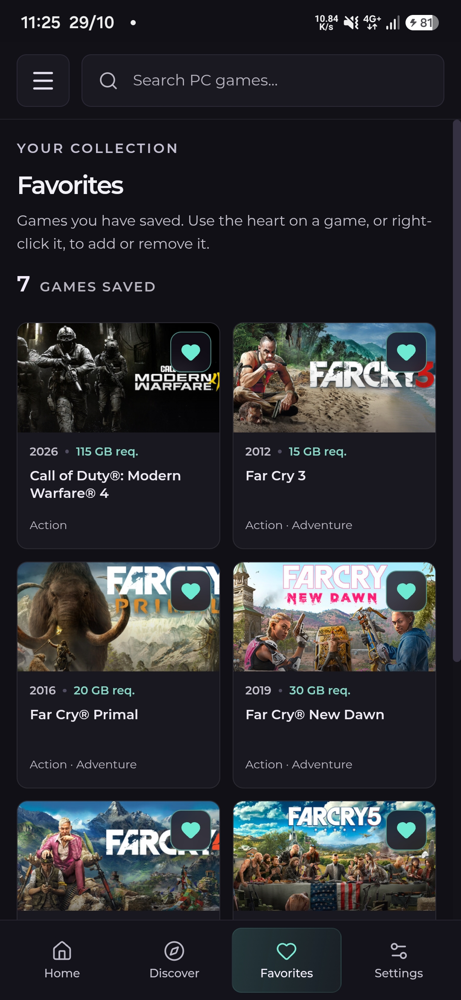
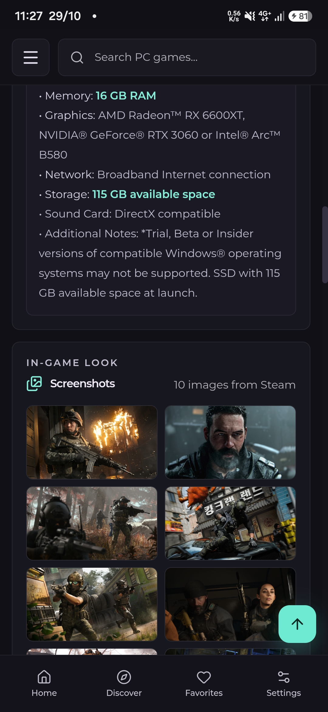
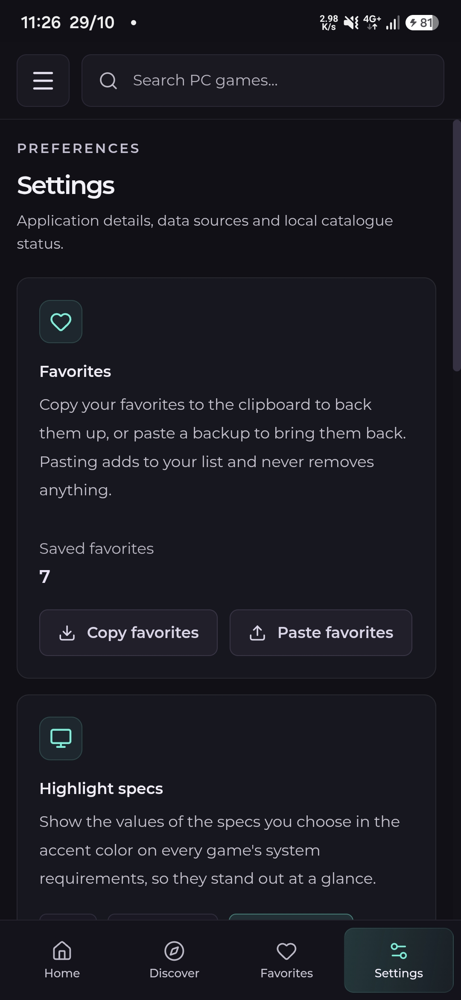

# Quode Palette Gamebook

**A PC game reference library for Android, by Quode Palette.**

  
  <b>Screenshot I</b>

<table>
    <td width="50%" align="center">
      
        
      <b>Screenshot II</b>
       
      <!-- Convert common audio formats with FFmpeg -->
    </td>
    <td width="50%" align="center">
      
       
      <b>Screenshot III</b>
       
      <!-- Convert common video formats with FFmpeg -->
    </td>
</table>
<table>
    <td width="50%" align="center">
      
       
      <b>Screenshot IV</b>
       
      <!-- Convert common audio formats with FFmpeg -->
    </td>
    <td width="50%" align="center">
      
       
      <b>Screenshot V</b>
       
      <!-- Convert common video formats with FFmpeg -->
    </td>
</table>

Search and browse PC games, check system requirements before you buy or install, and keep a personal list of favorites, all in one fast, ad-free app.

## What it does

- **Search and discover.** Find any PC game by title, or browse the latest releases, most reviewed and A to Z.
- **System requirements first.** Each game opens with its minimum and recommended specs. Pick the specs you care about (OS, processor, memory, graphics, network, storage) and they are highlighted everywhere.
- **Filter the catalogue.** Narrow by genre, release year, storage needed and minimum RAM.
- **Storage at a glance.** Required disk space is shown where the publisher lists it. Values from Steam are marked "req." because they are requirements, not exact install sizes. Unknown sizes are never guessed, and you can add a sourced value yourself.
- **Screenshots and trailers.** Pinch to zoom, swipe between shots, double-tap to zoom, and save any screenshot to your Gallery.
- **Favorites.** Tap the heart on any game. Favorites and your settings are kept on your device, with copy and paste backup in Settings.
- **Always current.** The catalogue updates itself when you open the app and when your connection returns. Saved games stay available offline.

## Install

1. Open the [**Releases**](../../releases/latest) page and download `Quode-Palette-Gamebook-v1.0.0-arm64.apk`.
2. Open the downloaded file on your phone.
3. If Android asks, allow installs from your browser or file manager ("Install unknown apps"), then tap **Install**.

**Requirements:** Android 7.0 or newer on a 64-bit (arm64) phone, which covers virtually every phone made in the last several years.

### Updating

Download the newer APK from Releases and install it over the old one. **Don't uninstall first**, because uninstalling removes your favorites and settings.

## Where things are saved

| What | Where |
| --- | --- |
| Favorites, settings, saved game records | Private to the app, on your phone |
| Saved screenshots | `Pictures / Quode Palette Gamebook` (shows up in your Gallery) |

If Google backup is turned on for your phone, your favorites and settings can be restored after a reinstall.

## Privacy

- No account, no sign-in, no ads, no analytics, no tracking.
- The app only asks for **internet access**, to fetch game information. It needs no other permission.
- Game data is requested from public Steam Store pages. Nothing about you is sent beyond what any web request involves.

## Good to know

- Game information, artwork and trademarks belong to their respective owners and come from the Steam Store. Details can vary by region and edition, and a store record may leave fields blank.
- Quode Palette Gamebook is an independent app. It is not affiliated with or endorsed by Valve or Steam.

## Font
The Montserrat font is under the SIL Open Font License.

## License

Released under the [PolyForm Noncommercial License 1.0.0](LICENSE). You are free to use, modify and share it for personal, educational and other noncommercial purposes. For commercial use, please get in touch.
[Email Us](mailto:hello@quodepalette.com)
